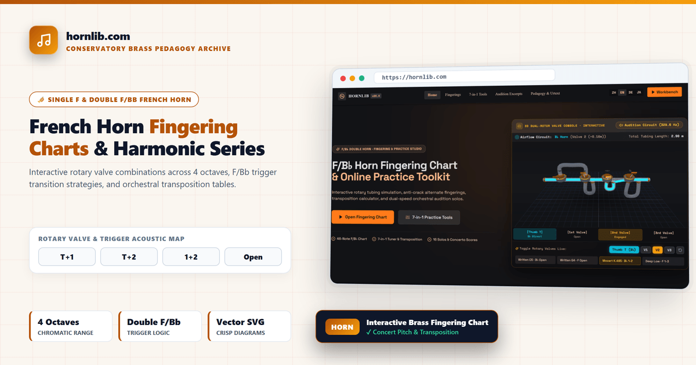
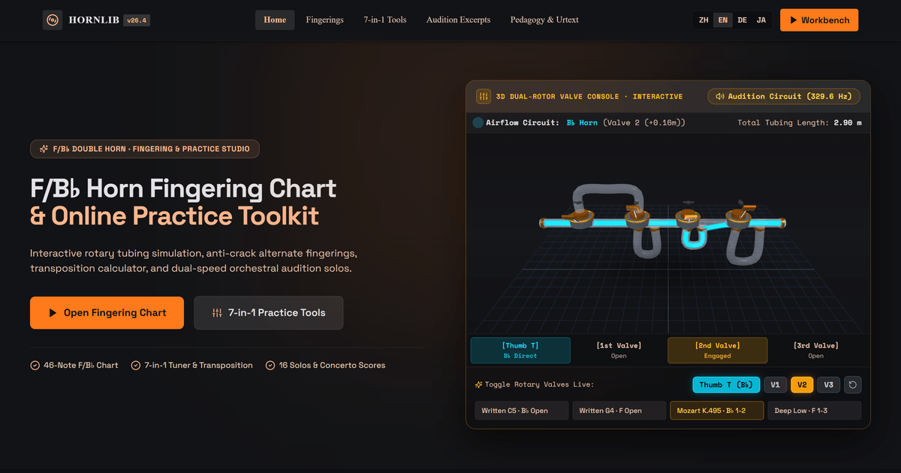
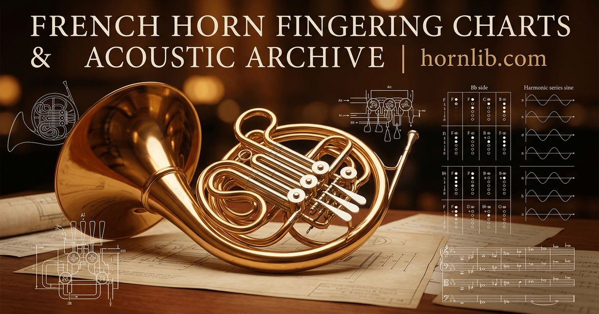

# HornLib — Interactive French Horn F/Bb Double Horn Fingering & Harmonics Engine (`com.hornlib/mcp`)

<p align="center">
  <a href="https://hornlib.com">
    
  </a>
</p>

<p align="center">
  <a href="https://mcptry.com/servers/com.hornlib/mcp"></a>
  <a href="https://aiagentslisting.com/mcp/mcp-server-3"></a>
  <a href="https://registry.modelcontextprotocol.io/v0.1/servers/com.hornlib%2Fmcp/versions/latest"></a>
  <a href="https://hornlib.com"></a>
  <a href="./LICENSE"></a>
</p>

> **Digital French horn fingering charts and transposed brass sheet music.**  
> **HornLib ([hornlib.com](https://hornlib.com))** offers interactive fingering charts for single and double horns (F/Bb), overtone harmonic series tables, and transposed brass warm-up etudes in crisp vector SVG — exposed to AI assistants via a stateless `streamable-http` **Model Context Protocol (MCP)** server.

---

## 🖥️ Interactive Web Studio Preview

<p align="center">
  <a href="https://hornlib.com/fingerings">
    
  </a>
</p>

### Why Hornists & Brass Pedagogues Choose HornLib
1. **Interactive Double Horn Trigger Toggle**: Dynamically switches between single F horn, single Bb horn, and full double horn (F/Bb trigger) valve combinations across the instrument's entire four-octave range.
2. **Harmonic Partial Intonation Deviation Charts**: Displays exact equal-temperament cent tendencies (e.g., `-14 cents` on the 5th partial, `-31 cents` on the 7th partial) alongside alternate valve solutions.
3. **Historical Orchestral Crook Transposition**: Assists hornists reading classical & romantic orchestral parts in **Horn in Eb, D, C-basso, G, A, E, Bb-alto, and Bb-basso**.

---

## 🛠️ 8 Read-Only MCP Tools (`https://hornlib.com/api/mcp`)

All 8 tools are strictly **read-only** (`readOnlyHint: true`, `destructiveHint: false`, `idempotentHint: true`) and require **zero API keys**:

| # | Tool Name | Capability & Music Theory Scope | Web Reference |
| :-: | :--- | :--- | :--- |
| 1 | `lookup_french_horn_fingering` | Look up F-side & Bb-trigger valve fingerings, concert pitch transposition, and intonation tendencies for any written note (`C2`–`F6`). | [Fingering Chart](https://hornlib.com/fingerings) |
| 2 | `transpose_french_horn_pitch` | Transpose orchestral horn parts from historical crooks (`Eb`, `D`, `C`, `G`, `A`, `E`, `Bb`) to modern Horn in F & Concert Pitch. | [7-in-1 Brass Tools](https://hornlib.com/7-in-1-tools) |
| 3 | `analyze_horn_harmonic_series` | Analyze natural overtone partials (2nd–16th) for any F or Bb valve combination with cent deviations. | [All Notes & Harmonics](https://hornlib.com/all-notes) |
| 4 | `lookup_horn_trill_fingering` | Identify mechanical valve trills vs Viennese harmonic lip trills for whole-step and half-step ornaments. | [Trill Fingerings](https://hornlib.com/fingerings) |
| 5 | `get_orchestral_horn_excerpt_guide` | Audition preparation notes, crook shifts & fingerings for Mozart 4, Strauss *Till Eulenspiegel*, Tchaikovsky 5, Brahms & Mahler. | [Orchestral Excerpts](https://hornlib.com/excerpts) |
| 6 | `diagnose_horn_intonation_and_hand_position` | Acoustic diagnostic for Stopped Horn (`gestopft` `+1/2` step F-horn transposition) & right-hand bell cupping. | [Pedagogy Guides](https://hornlib.com/guides-pedagogy) |
| 7 | `recommend_beginner_horn_and_mouthpiece` | Compare Kruspe wrap (Conn 8D) vs Geyer wrap (Alexander 103 / Yamaha) & mouthpiece cup depths (Farkas, Laskey, Schilke). | [Beginner Guide](https://hornlib.com/beginners) |
| 8 | `generate_daily_horn_warmup_routine` | Generate structured daily warm-up routines covering Farkas long tones, harmonic lip slurs, tonguing & pedal tones. | [Knowledge Base](https://hornlib.com/knowledge) |

---

## ⚡ Quick Setup (Claude Desktop / Claude Code / Cursor / Windsurf)

### Direct Remote `streamable-http` Connection (Recommended)
```json
{
  "mcpServers": {
    "hornlib": {
      "url": "https://hornlib.com/api/mcp"
    }
  }
}
```

### Claude Code CLI
```bash
claude mcp add --transport http hornlib https://hornlib.com/api/mcp
```

---

## ❓ Frequently Asked Questions (FAQ)

- **Q: Does HornLib cover double horn trigger fingerings?**  
  **A:** Yes — full F-side and Bb-side trigger fingerings are clearly differentiated, including standard crossover points around written `G#4`/`A4`/`Bb4`.
- **Q: Are warm-up routines and orchestral studies available?**  
  **A:** Yes — public-domain overtone studies, Kopprasch etudes, and orchestral audition excerpts are available directly on [hornlib.com](https://hornlib.com).

<p align="center">
  <a href="https://hornlib.com">
    
  </a>
</p>

---

## 🔗 Official Resources & Deep Links

- **[French Horn Fingering Chart (Interactive Studio)](https://hornlib.com)**
- **[Double Horn F/Bb Trigger Fingering Reference](https://hornlib.com/fingerings)**
- **[7-in-1 French Horn Transposition & Practice Suite](https://hornlib.com/7-in-1-tools)**
- **[Orchestral French Horn Audition Excerpts](https://hornlib.com/excerpts)**
- **[French Horn Beginner Guide & Mouthpiece Selector](https://hornlib.com/beginners)**
- **[LLMs.txt Structured AI Reference](https://hornlib.com/llms.txt)**

*Educational music resource curated by professional brass pedagogues. MIT License © [HornLib (hornlib.com)](https://hornlib.com).*
